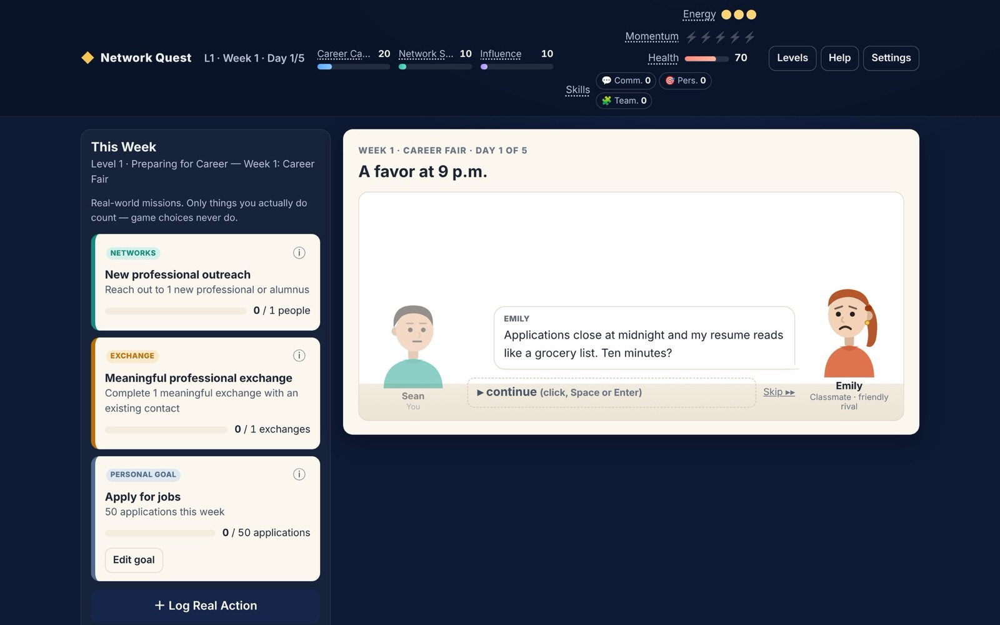
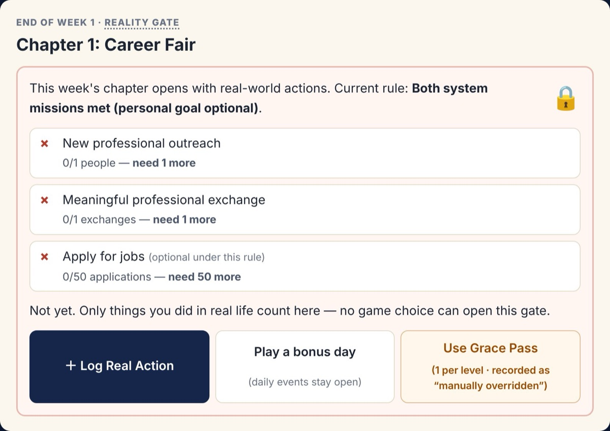
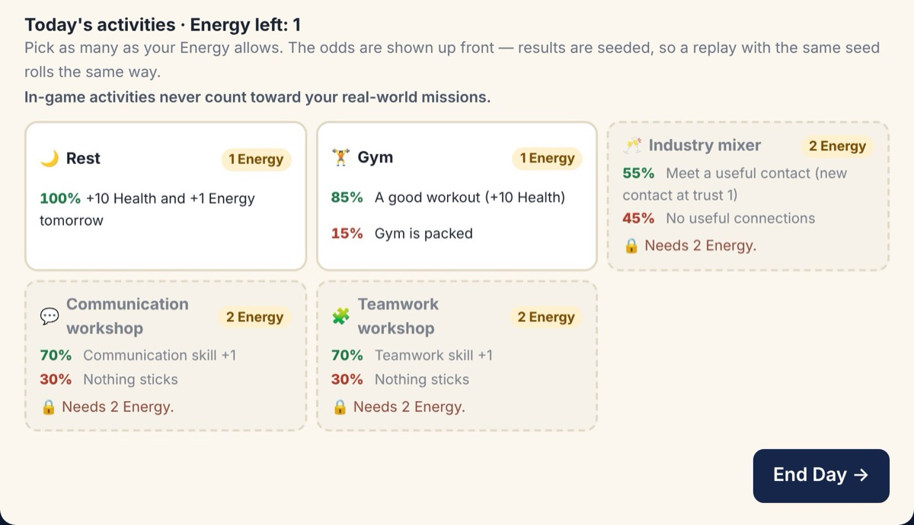
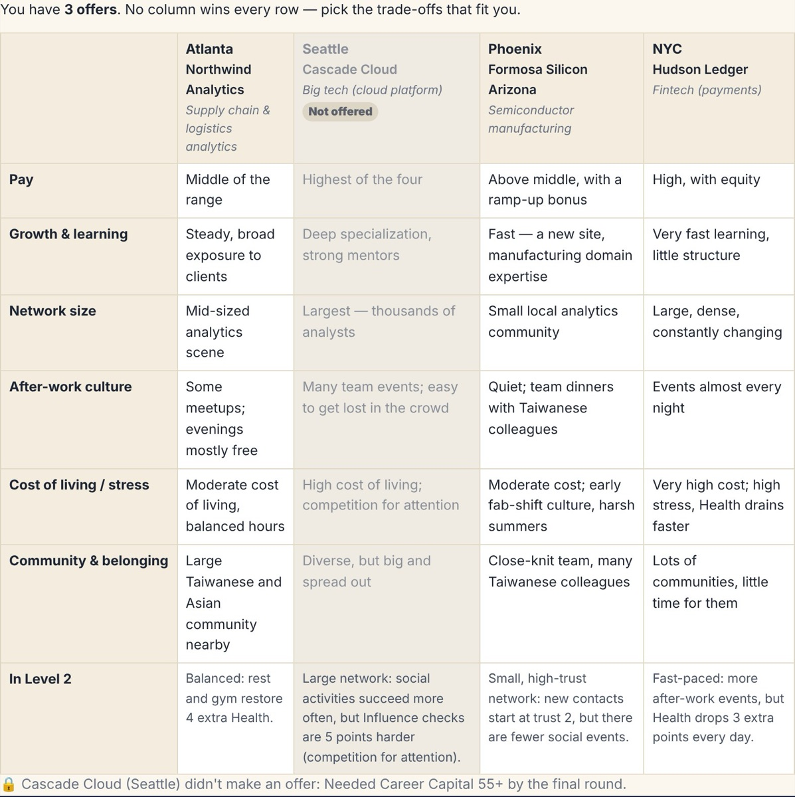
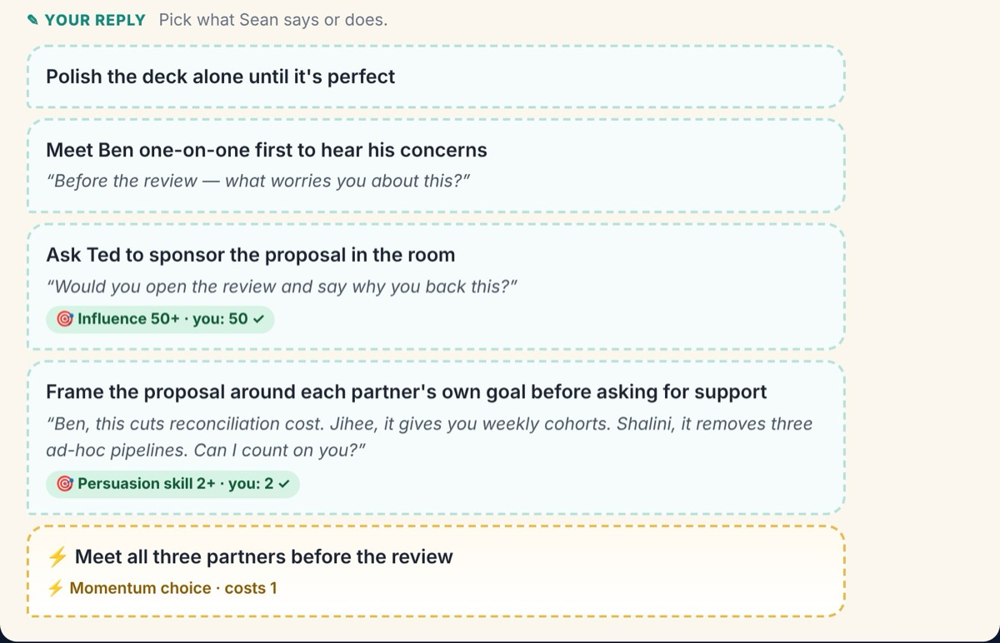
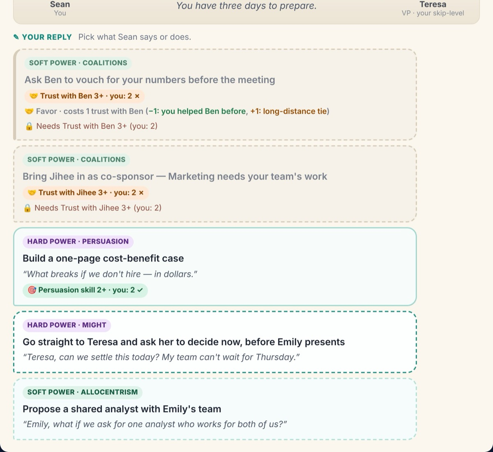
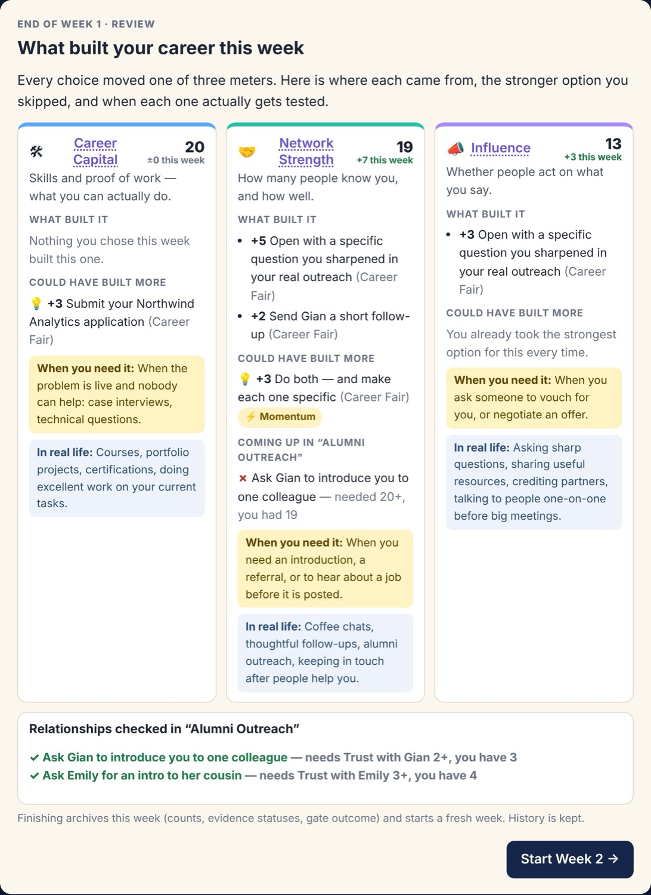

Knowing networking matters is not the same as doing it. Network Quest is a career strategy RPG where real-world networking unlocks the story. **The one rule:** game choices never count. Only real-world actions open the next chapter.

```{=html}
<div class="play-actions">
  <a class="btn btn-primary" href="../../games/network-quest/index.html" target="_blank" rel="noopener">▶ Play full screen</a>
  <a class="btn btn-outline-secondary" href="https://github.com/rsm-b5hsu/decision-making-career-game" target="_blank" rel="noopener">Source code on GitHub</a>
</div>
<div class="game-embed column-page" id="game-embed">
  <button type="button" class="game-poster" aria-label="Load Network Quest on this page">
    
    <span>▶ Play here</span>
  </button>
</div>
<script>
document.querySelector("#game-embed .game-poster").addEventListener("click", function () {
  var f = document.createElement("iframe");
  f.src = "../../games/network-quest/index.html";
  f.title = "Network Quest game";
  var box = document.getElementById("game-embed");
  box.classList.add("playing");
  box.replaceChildren(f);
});
</script>
```

::: {.callout-tip title="Short on time? Use Demo Mode"}
The game asks for real outreach, so a casual visit would stop at the first gate. To see more:

1. Click through the 4-step intro and the Level 1 prologue ("Skip ▸▸" speeds up any dialogue), then play Week 1, Day 1.
2. Open **🎛 Demo Mode** (bottom right) and jump to Week 5 of the level, or jump to the Reality Gate.
3. Click **Fill sample evidence (DEMO SAMPLE)** and close the panel. The gate opens.
4. Play Chapter 5, choose an offer, finish the weekly check-in, and start the next level.
:::

# How the game works

A weekly loop, daily decisions, and three levels built on course concepts.

## A weekly loop with a Reality Gate

::: {.flow}
::: {.flow-step}
**1. Play a day (2–5 minutes)**
[A short dialogue, one choice, then activities with the odds shown up front.]{.small}
:::
::: {.flow-step}
**2. See the consequences**
[Career Capital, Network Strength, Influence and trust move; some pay off weeks later.]{.small}
:::
::: {.flow-step .accent}
**3. Hit the Reality Gate**
[After Day 5 the chapter stays locked until this week's real missions are met.]{.small}
:::
::: {.flow-step}
**4. Log real actions → unlock**
[Screenshot, reflection or self-report. Each log earns ⚡ Momentum for strong choices.]{.small}
:::
:::

{.game-shot fig-alt="Reality Gate screen listing the missions still needed, with buttons to log a real action, play a bonus day or use a Grace Pass"}

The gate lists what is missing. Players can log a real action, play a bonus day, or use one Grace Pass per level (recorded as "manually overridden"). Targets rise each week.

## Inside a week: each day is one small decision

Visual-novel dialogue on the right, this week's real missions on the left (actual / target).

- **Energy:** 3 a day for choices and activities
- **Health:** late nights cost Energy later
- **Skills:** workshops raise 3 skills (0–3)
- **Trust 0–5:** earn by helping, spend on favors

{.game-shot fig-alt="Five daily activities with Energy costs and success odds, some locked for lack of Energy"}

## Level 1: Land a job offer

[Final-semester MSBA student · 5 weeks]{.note-muted}

| Week | Story chapter | Networks | Exchange |
|:-:|:--|:-:|:-:|
| 1 | Career Fair | 1 | 1 |
| 2 | Alumni Outreach | 2 | 1 |
| 3 | Coffee Chats | 3 | 2 |
| 4 | Interviews | 4 | 2 |
| 5 | The Offer | 5 | 3 |

: Real targets per week

**Networks:** reach out to someone new with a tailored message. **Exchange:** give or get useful insight in a real two-way conversation.

**The Offer:** 3 of 4 fictional offers (Atlanta, Seattle, Phoenix, NYC) appear depending on how you played. No option wins every row, so the choice is about trade-offs.

{.game-shot fig-alt="Comparison table of four fictional job offers by pay, growth, network size, culture, cost and community, with Seattle greyed out"}

## Level 2: Build support across teams

[New data analyst · 5 weeks]{.note-muted}

| Week | Story chapter | Networks | Coalitions |
|:-:|:--|:-:|:-:|
| 1 | Onboarding | 1 | 1 |
| 2 | Stakeholder Discovery | 1 | 1 |
| 3 | First Shared Project | 2 | 2 |
| 4 | Building Support | 2 | 2 |
| 5 | Leadership Presentation | 3 | 3 |

: Real targets per week

**Networks:** start or deepen a professional connection with anyone, inside or outside the company. **Coalitions:** engage a stakeholder about an idea, even if they disagree.

Your offer city matters: it changes the intro, events, starting modifiers and a Week 3 surprise (ramp delay, reorg, team expansion, manager leaves). A good decision is not a guaranteed outcome.

Level 1 choices carry over ("Remembered"). Strong options need Influence, skills or allies built earlier.

{.game-shot fig-alt="Level 2 reply options, including ones requiring Influence 50 and Persuasion skill 2"}

## Level 3: Lead a team, win the budget

[First-time manager · 5 weeks]{.note-muted}

| Week | Story chapter | Political Capital | Recognition / Feedback |
|:-:|:--|:-:|:-:|
| 1 | New Manager | 1 | 1 |
| 2 | Team Diagnosis | 1 | 1 |
| 3 | Competing Priorities | 2 | 2 |
| 4 | The Budget Fight | 2 | 2 |
| 5 | Leadership Review | 3 | 3 |

: Real targets per week

**Political Capital:** build trust and support with your boss or senior managers. **Recognition / Feedback:** give a team member specific recognition or coaching feedback.

New meters: Team Morale and Political Capital. Every choice is tagged soft power (Team, Allocentrism, Coalitions) or hard power (Persuasion, Might, Ethos). Hard power is faster now; soft power takes setup but lasts.

{.game-shot fig-alt="Level 3 reply options tagged soft power or hard power, with two coalition options locked for lack of trust"}

## Concepts in the mechanics

| Concept | How the game uses it |
|:--|:--|
| Reciprocity | Help someone first and their favor costs 1 less trust |
| Opportunity cost | 3 Energy a day; every option shows its cost |
| Networks | Real outreach opens each chapter; trust 0–5 per contact |
| Delayed consequences | "Remembered" callbacks across chapters and levels |
| Decision ≠ outcome | Odds shown up front; each offer brings a later surprise |
| Coalitions | Level 2 options need allies at trust 3+ |
| Soft vs. hard power | Level 3 tags: fast hard power vs. lasting soft power |

The week review shows what built each meter, the stronger option skipped, and when you need it next.

{.game-shot fig-alt="Week review showing Career Capital, Network Strength and Influence, what built each and what could have built more"}

## About this project

The story, characters, companies and offers are fictional. Evidence is never verified, the weekly email is a preview only, and your progress stays in your own browser.

**Tools:** HTML · CSS · JavaScript (ES modules) · no frameworks, backend or API calls

[UCSD MSBA · MGTA 459 Managerial Decision Making · Fall 2026]{.note-muted}
